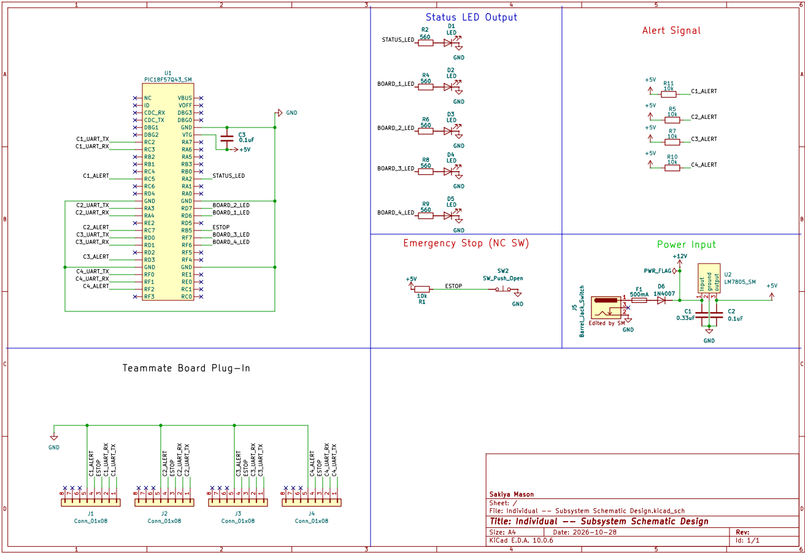

## Overview

This schematic is designed to support the mod bus portion of the gripper end effector group project.

{style width:"350" height:"300;"}
**Figure 1:** Showing my schematic.

## Resouces

The schematic as a PDF download is available [*here*](Individual -- Subsystem Schematic Design.pdf), and the Zip folder of the project [*here*](dummyZip.zip).