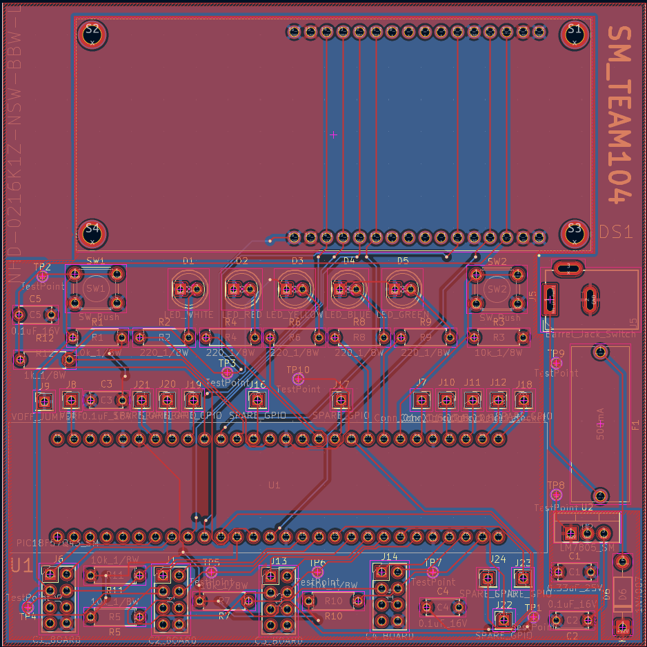

## Overview

This PCB Design is designed to support the mod bus portion of the gripper end effector group project.

{style width:"350" height:"300;"}
**Figure 1:** Showing the front of my PCB Design.

## Resouces

The PCB layout as a PDF download is available [*here*](PCB_DESIGN.pdf), the Zip folder of the KiCad project [*here*](schematicZip.zip), and the Zip folder of the Gerber and drill files [*here*](Mason_Sakiya_Team104.zip).